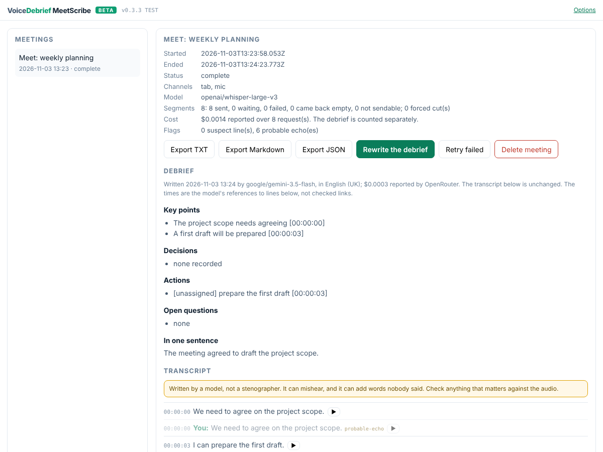

# MeetScribe: a transcript and a debrief of your Google Meet calls

Transcribes the Google Meet call you are in and writes the debrief: key points, decisions, actions, open questions. It runs as a Chrome extension on your own OpenRouter key. There is no bot in the call, no Google recording or transcription (so it works on Workspace Business Starter, which has neither), and no server of ours. Your own words are labelled **You**; everything else is the call, and every point in the debrief carries the time of the line it came from.

[Download MeetScribe v0.3.3 (zip, 52 KB)](releases/meetscribe-latest.zip)

> **Beta: do not use it for confidential meetings.** Everything you transcribe is sent to OpenRouter, a third party, and what happens to it there is outside our control and our view. [Where your audio goes](#where-your-audio-goes) says exactly what that means.
>
> This build follows [a code review of 18 findings](reviews/index.md) and the first real calls: capturing the call works; the microphone is being checked. It has been tested in Chromium with fake audio and replayed responses (63 automated tests), and **its first real Meet calls are being made now**. Expect rough edges, and please [tell us what happened](https://github.com/VoiceDebrief/VoiceDebrief__Chrome_Extension__MeetScribe/issues/new?template=test-report.md).

## Try it in five minutes

1. **Download and unzip** [the zip](releases/meetscribe-latest.zip). You get a folder called `meetscribe`.
2. **Load it in Chrome.** Open `chrome://extensions`, switch on **Developer mode** (top right), press **Load unpacked** and pick the `meetscribe` folder. Pin **VoiceDebrief MeetScribe** to the toolbar.
3. **Add your OpenRouter key.** The options page opens by itself. Paste a key and press **Save and test**. No key yet? [Get one in five steps](https://voicedebrief.ai/openrouter-key/), and **set a credit limit on it**: a few dollars is plenty.
4. **In a Meet call,** go to the Meet tab and click the MeetScribe icon in Chrome's toolbar. That click is what lets Chrome capture the tab; the side panel opens and names the tab. Tell the others you are transcribing (there is a notice to copy into Meet's chat), tick the box, press **Start transcribing**.
5. **After the call,** press **Stop**, open **Meetings**, and press **Write the debrief**. Export it as Markdown, text or JSON.

Want your own voice transcribed as well? Press **Allow the microphone** on the options page once, then tick **Also transcribe my microphone** before you start. It has its own mute (<kbd>Alt</kbd>+<kbd>Shift</kbd>+<kbd>M</kbd>), separate from Meet's. Use headphones, or your microphone will hear the call too.

[The full guide, with screenshots](install/index.md) · [What to do when something goes wrong](develop/index.md#when-something-goes-wrong)

## What you need

| | |
|---|---|
| Chrome | Version 116 or later, on a computer (Windows, macOS, Linux, ChromeOS) |
| An OpenRouter key | With credit on it. MeetScribe, like [voicedebrief.ai](https://voicedebrief.ai), charges nothing and adds no margin: you pay OpenRouter directly |
| A Google Meet call | Any Google account or Workspace edition |

**What it costs.** At OpenRouter's listed prices on 3 November 2026, an hour of meeting costs roughly **5 to 15 US cents**. That is about 3 to 11 cents to transcribe with the default `openai/whisper-large-v3`, depending on the provider OpenRouter picks, plus about 2 to 3 cents for the debrief with `google/gemini-3.5-flash`. Silence is never sent. Each meeting shows the cost OpenRouter actually reported; [the models page](models/index.md) lists every transcription model's price.

## Where your audio goes

**On our side, everything is client-side.** MeetScribe has no server, no account and no analytics. Your meetings, transcripts, debriefs, the audio waiting to be sent and your key stay in this browser profile. They are stored like any extension's data, not encrypted, so anyone with access to your computer and Chrome profile can read them. **Delete all MeetScribe data** is on the options page; your key and settings are cleared separately.

**Once audio leaves your browser, it is out of our hands.** Your audio and its transcript are sent to OpenRouter, which passes them to a model provider. We do not know which provider handles your recording, and we have no control over what they do with it. We cannot see or verify who processes it, whether it is kept, or for how long.

MeetScribe asks OpenRouter for zero-data-retention routing. That is a request, applied according to your OpenRouter account's own settings, which we cannot see. It is not a guarantee we can give, so please don't read it as one.

**So, during the beta: treat everything you transcribe as shared with a third party, and do not use MeetScribe for anything confidential.**

**Consent is yours to get.** Meet's own recording tells everyone in the call; MeetScribe cannot, so it asks you to, every meeting. Recording or transcribing people without their consent is unlawful in some places.

## What to expect

- **It listens only while you can see it listening.** The icon shows **REC**, Chrome shows its own capture indicator, and Stop is one click away. Closing the Meet tab also stops it.
- **It is built not to lose speech quietly.** Every stretch of speech is saved before it is sent. If the network drops or the key runs out, it waits and retries. What failed or came back empty shows as a gap with a reason and a retry. This is the design, tested with fake audio, and the beta is where it meets real calls.
- **It tries not to guess.** It does not know who in the call said what, so it does not guess: only your own microphone's lines are labelled (**You**). A line that looks like your microphone hearing the call is dimmed (`probable-echo`) rather than deleted, and so is a phrase models invent from silence (`suspect`). Both flags are heuristics and can be wrong.
- **Not there yet:** names for the other speakers, editing the transcript, search across meetings, and the Chrome Web Store. [What is built](built/index.md) is the honest list.

## Tell us what happened

[Report a test](https://github.com/VoiceDebrief/VoiceDebrief__Chrome_Extension__MeetScribe/issues/new?template=test-report.md) as a GitHub issue, using a short form: what worked, what did not, and the eight questions this beta is meant to answer. Screenshots and exported transcripts help, but **remove anything private first**: an issue is public.

## How it was built

MeetScribe started as a brief drafted by ChatGPT. It was reviewed claim by claim, rewritten, and built with the tests first. Everything below is the record.

### Is it feasible?

Yes. Every API it needs exists and is documented: Chrome's tab capture into an offscreen document (Chrome 116 and later), `getUserMedia` for the microphone, and OpenRouter's `/api/v1/audio/transcriptions`, which listed 29 models on the day we looked. Nothing depends on Google, which matters: Google is shutting down the Meet Media API on 15 January 2027.

The first brief (v1.0, drafted by ChatGPT) had the facts mostly right and four choices that would have failed without an error:

| | What v1.0 did | What goes wrong | v2.0 |
|---|---|---|---|
| R1 | 20-second `MediaRecorder` chunks | Only the first chunk is a decodable file; the model invents text for the rest | Own the samples: worklet, 16 kHz PCM, a WAV per segment |
| R2, R3 | Fixed cuts with overlap; every segment sent | Words cut in half; silence comes back as "Thank you for watching" | Cut at pauses; drop silence before it is sent |
| R4 | Its own microphone stream | Records you while you are muted in Meet | Opt-in per meeting, its own mute and shortcut, said plainly |
| R5 | "Mic = You" | On speakers, the mic hears everyone; their words become yours | Echo cancellation, measured; echoes marked, never deleted |

The [review](review/index.md) has all 23 findings, the 14 claims that held, and a verdict on every section of v1.0.

### Read

- [Install and use v0.3.0](install/index.md): load unpacked, set the key, transcribe a call, write the debrief; a short script for the first real test.
- [Build, test and release](develop/index.md): no compile step; stamping, the tests, the gate, the site, the release and what CI does.
- [MeetScribe and VoiceDebrief](voicedebrief/index.md): what it shares with voicedebrief.ai, what differs, and the path into the website.
- [What is built](built/index.md): the reality file, with what building it corrected.
- [Review of brief v1.0](review/index.md): what holds, what is wrong, what is missing, what to change, with evidence.
- [Brief v2.0](brief/index.md): the specification to build from.
- [The plan](plan/index.md): Phase 0's eight go/no-go questions and the model bake-off, then three releases.
- [Transcription models](models/index.md): the OpenRouter catalogue with price per hour, from a dated snapshot.
- [Sources](sources/index.md): every fact, where it was read.
- [Brief v1.0, as received](brief/v1/index.md): kept unedited.

### Where it comes from

MeetScribe is a VoiceDebrief product, and the Chrome extension the [VoiceDebrief](https://voicedebrief.ai) brief deliberately left for later: the same bring-your-own-key OpenRouter model, the same rule that the transcript is never overwritten, and the lessons of its issue queue. It is built the way the [chrome-extensions.sgit.ai](https://chrome-extensions.sgit.ai) hub and [Fix the Page](https://fix-the-page.chrome-extension.sgit.ai) say extensions should be: a deliberately stupid recorder first, `null` never `0`, no remote code, and a release you can check against its source.
