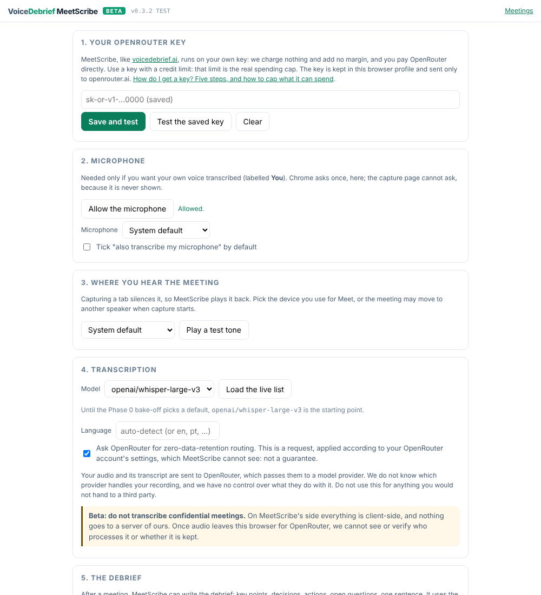
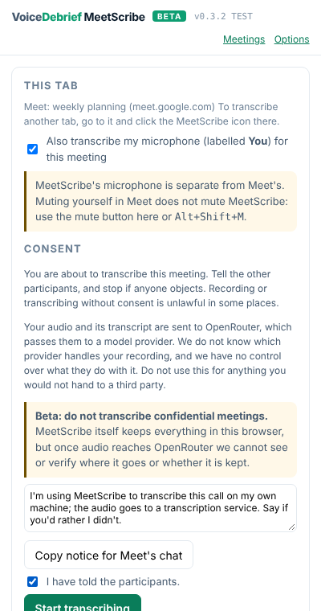
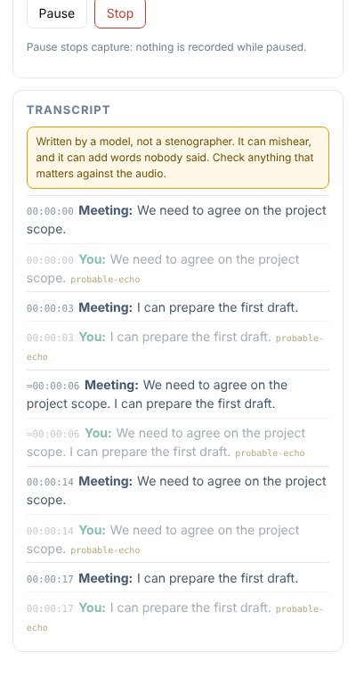
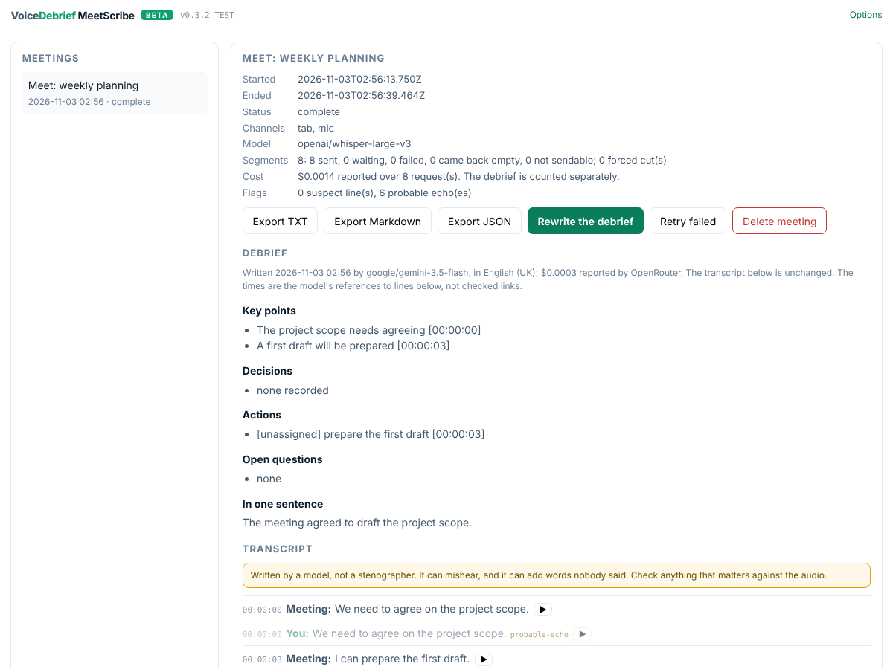

# Install and use MeetScribe v0.3.2

> **Beta: do not use it for confidential meetings.** MeetScribe keeps everything in your browser, but the audio and transcript go to OpenRouter and on to a model provider, where we cannot see or verify what happens to them. [Where your audio goes](../index.md#where-your-audio-goes) has the detail.

MeetScribe is not in the Chrome Web Store yet. You load it yourself, which takes about two minutes, from a zip or from a clone of the repository. Both hold exactly the same files. [Build, test and release](../develop/index.md) has the developer's side.

## Install from the zip (most people)

1. Download [meetscribe-latest.zip](../releases/meetscribe-latest.zip) and unzip it. You get a folder called `meetscribe`; keep it somewhere it will stay, because Chrome loads it from there.
2. Open `chrome://extensions` (type it into the address bar) and switch on **Developer mode**, top right.
3. Press **Load unpacked** and pick the `meetscribe` folder.
4. Pin **VoiceDebrief MeetScribe** to the toolbar (the puzzle-piece icon, then the pin). The options page opens by itself the first time.

To update, download the new zip, replace the folder's contents, and press the reload arrow on MeetScribe's card in `chrome://extensions`. Your meetings and settings are kept.

Every release is kept as `releases/meetscribe-vX.Y.Z.zip`, with a `.sha256` beside it. The zip holds exactly the repository's `extension/` folder, byte for byte: the release gate checks it. To check the file you downloaded:

```bash
shasum -a 256 meetscribe-latest.zip
```

and compare with [meetscribe-latest.zip.sha256](../releases/meetscribe-latest.zip.sha256).

## Install from a clone (developers)

```bash
git clone https://github.com/VoiceDebrief/VoiceDebrief__Chrome_Extension__MeetScribe.git
```

Then **Load unpacked** and pick the repository's `extension/` folder. After a `git pull`, press the reload arrow on MeetScribe's card. The options page shows the version, commit and build time, so you can check which build is running.

## Set up (once)



1. **OpenRouter key.** Paste a key you made for MeetScribe, **with a credit limit**, and press **Save and test**. It saves the key and shows its usage and limit.
2. **Microphone.** Press **Allow the microphone** only if you want your own voice transcribed. Chrome asks here because the capture page is never shown and cannot ask.
3. **Where you hear the meeting.** Pick the headset or speakers you use for Meet, and press **Play a test tone**.
4. **Model.** **Load the live list** shows every OpenRouter transcription model with its listed price per hour. `openai/whisper-large-v3` is the starting point until the Phase 0 bake-off picks a default.
5. **The debrief.** Pick the language it is written in (voicedebrief.ai's four: English UK or US, Portuguese Portugal or Brazil). The model defaults to `google/gemini-3.5-flash`, as on voicedebrief.ai.

## Use it in a meeting



1. Join the Meet call. **While on the Meet tab**, click the MeetScribe icon in Chrome's toolbar (or press <kbd>Alt</kbd>+<kbd>Shift</kbd>+<kbd>S</kbd>). That click is what lets Chrome capture the tab. The side panel opens beside Meet and names the tab it will capture. To capture a different tab, go to it and click the icon there.
2. If you want your own voice too, tick **Also transcribe my microphone**. It is separate from Meet's mute: use the panel's **Mute my mic** or <kbd>Alt</kbd>+<kbd>Shift</kbd>+<kbd>M</kbd>.
3. Tell the participants: **Copy notice for Meet's chat** and paste it into the chat. Then tick **I have told the participants** and press **Start transcribing**. The icon shows **REC**.
4. Lines appear in the panel a few seconds after each pause in speech. **Meeting** is the call; **You** is your microphone. Dimmed lines are flagged (`probable-echo`, `suspect`), never deleted.
5. **Stop**, or close the Meet tab. MeetScribe sends what is still waiting and marks the meeting complete.



## Afterwards

**Meetings** (in the panel's header) lists every meeting. You can:

- press **Write the debrief** for voicedebrief.ai's debrief of the meeting (key points, decisions, actions, open questions, one sentence), each point with the time of the line it came from. The transcript is never changed.
- read the transcript with its gaps, and play the audio any line came from (▶).
- retry failed segments.
- export TXT, Markdown (with the debrief) or JSON.
- delete a meeting.

**Delete all MeetScribe data** is on the options page.



## What this build answers for the Phase 0 spike

Each spike question from [the plan](../plan/index.md) can be answered with this build on a real call. Please note what you see:

| | Question | How to see it |
|---|---|---|
| S1 | Does Start capture the Meet tab after clicking the icon on it? (Answered "no" for opening the panel straight from the icon, on the first real call; v0.3.2 changed the route) | The panel names the tab before you start; if capture fails, the panel says why and the message stays |
| S2 | Does the microphone work in the capture page after the one-time grant? | A microphone problem shows under the meters and on the meeting page |
| S3 | How much of the meeting leaks into your microphone on speakers? | Count the dimmed `probable-echo` lines with and without headphones |
| S4 | Memory over 2 hours | `chrome://extensions`, MeetScribe, inspect `offscreen.html`, Memory tab |
| S5 | Do the cuts fall between words? | The meeting page's "forced cut(s)" count; play a segment with ▶ |
| S6 | Which model? | Change the model on the options page between meetings; the meeting page shows the cost OpenRouter reported |
| S7 | Is the mic captured while muted in Meet? | Mute in Meet only and speak: a **You** line appears (expected: yes) |
| S8 | Does the meeting stay on your headset? | Pick it in options; listen when you press Start |

## A first test: a short script

1. Install or update, and check the options page's footer shows **0.3.2**.
2. Make or reuse a capped OpenRouter key; **Save and test**.
3. A two-person Meet call, headphones on, microphone **on**. Talk for five minutes, with one stretch muted in Meet only (S7).
4. Stop. On the meeting page, check that every second is a line, a gap with a reason, or silence. Play two segments with ▶. Count the forced cuts (S5).
5. **Write the debrief**; check every point against the line its time names.
6. Again on laptop speakers, to count the `probable-echo` lines (S3).
7. Export Markdown and JSON, and [report the test](https://github.com/VoiceDebrief/VoiceDebrief__Chrome_Extension__MeetScribe/issues/new?template=test-report.md): the form asks the eight spike questions.

The developer's side (stamping, tests, the gate, release) is on [Build, test and release](../develop/index.md).
